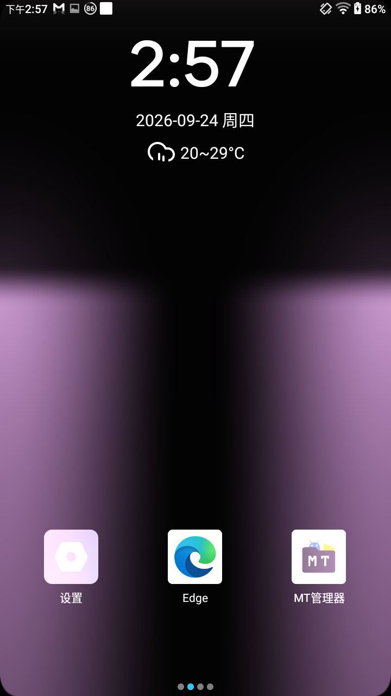
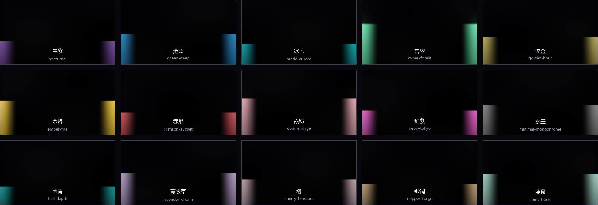
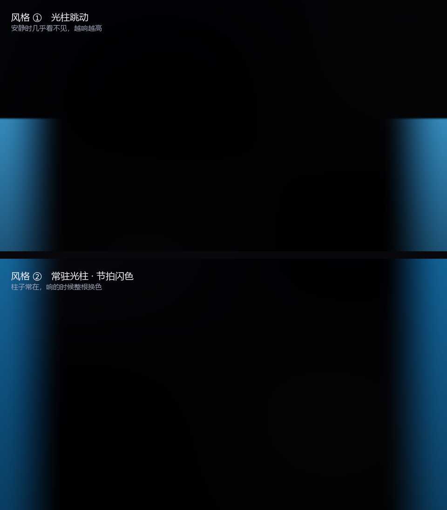
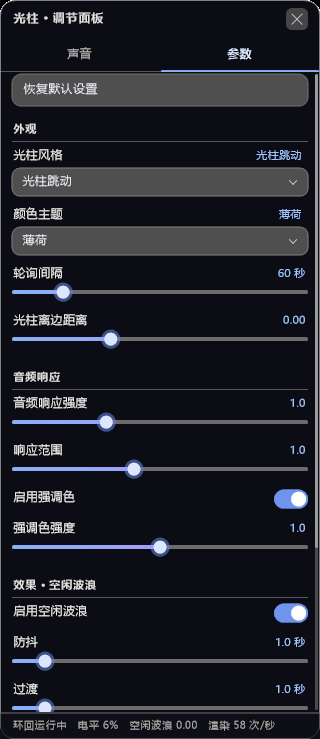
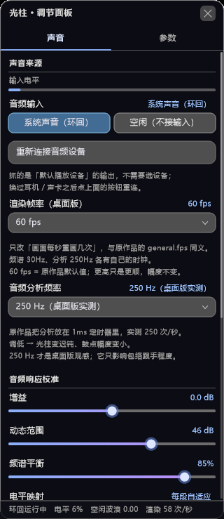

<div align="center">


# Light Pillar · 两边光柱

**把 Wallpaper Engine 里的音频律动光柱，做成不挡桌面的透明覆盖层。**

屏幕左右两边各一道光柱，跟着音乐起伏。它只加光、不铺黑底 ——
底下的桌面、图标、壁纸照常可见可点。

Windows 原生 · Android 悬浮窗 · 同一套着色器数学

[](https://github.com/IMYC001/musical-rhythm-light-pillar/actions/workflows/build-windows.yml)
[](https://github.com/IMYC001/musical-rhythm-light-pillar/actions/workflows/build-android.yml)
[](LICENSE)

</div>

---

## 目录

- [这是什么](#这是什么)
- [效果](#效果)
- [两个版本](#两个版本)
- [快速开始](#快速开始)
- [它怎么工作](#它怎么工作)
- [参数](#参数)
- [自己编译](#自己编译)
- [仓库结构](#仓库结构)
- [已知限制](#已知限制)
- [授权与致谢](#授权与致谢)

---

## 这是什么

一个**音频可视化覆盖层**：解析系统正在播放的声音，把低频能量变成屏幕两边竖直光柱的高度与颜色。

它不是一个普通的窗口。Windows 版把画面直接交给 DWM 合成器（DirectComposition +
预乘 alpha），Android 版用全屏透明悬浮窗 —— 两个平台的共同点是：

- **只加光，不盖黑底。** 输出的每个像素是 `RGB + 桌面 × (1 − A)`，
  `A` 默认只有 10%，所以桌面只是被「压暗一点点」，光柱像真光打上去。
- **不挡鼠标。** Windows 版整窗 `WS_EX_TRANSPARENT`，Android 版 `FLAG_NOT_TOUCHABLE`。
- **铺满整块屏幕。** 包括任务栏 / 状态栏所在的那一条，不做任何避让。

原始视觉来自 Wallpaper Engine 创意工坊作品 **「音域回响」**（[3747222633](https://steamcommunity.com/sharedfiles/filedetails/?id=3747222633)，
作者 [CmzYa](https://www.ifdian.net/a/CmzYa)）的网页版实现。这个仓库是把它从浏览器里
**搬到系统层**的完整移植 —— 着色器的距离场、软饱和、两种风格的分支、空闲呼吸、
染色顺序全部逐字保留，改的只有「怎么把画面送到屏幕上」和「声音从哪来」。

---

## 效果

### 实机（Android）

<div align="center">

</div>

桌面图标、壁纸、状态栏全都照常可见 —— 覆盖层只往上加光，不铺任何底色。
这张是 480×640 真机截图，不是渲染图。

### 15 套配色

<div align="center">

</div>

配色表由原作品的 bundle **逐字抽取**生成（`windows/scripts/gen_data.js`），
不是手抄 —— 15 套 × 4 个颜色 = 60 个线性色值，抄错一位整根柱子就偏色。

### 两种光柱风格

<div align="center">

</div>

| | 风格 ①　光柱跳动 | 风格 ②　常驻光柱 · 节拍闪色 |
|---|---|---|
| 柱高 | 由低频能量驱动，随音乐上下跳 | 恒为满屏高 |
| 安静时 | 几乎看不见 | 常驻，颜色最冷 |
| 响的时候 | 变高、变暖、顶端圆化成光晕 | 整根换成强调色并提亮，约半秒回落 |
| 顶端 | 低幅时平边，接近满幅才圆 | 不做圆化 |

两种风格用的是**同一根驱动量**，所以「跳多高」和「闪多亮」永远同起同落。

### 调节面板

<div align="center">


</div>

Windows 版是托盘里点开的自绘面板（两页：**声音** / **参数**），布局、分组、
滑杆手感都对着原作品的网页面板做。Android 版是一张可滚动的设置页，参数一一对应。

---

## 两个版本

| | Windows | Android |
|---|---|---|
| 产物 | 单文件 `LightPillar.exe`（约 650 KB） | `LightPillar.apk`（约 5.7 MB） |
| 依赖 | 无。静态链接，不需要 .NET / VC 运行库 | Android 8.0+（API 26） |
| 渲染 | D3D11 + DirectComposition，预乘 alpha | GLES 2.0 全屏透明悬浮窗 |
| 声音 | WASAPI loopback（抓系统输出，无需虚拟声卡） | 麦克风 / 内部音频（MediaProjection，需授权） |
| 入口 | 托盘图标 → 面板 / 退出 | 桌面图标 → 设置页 → 启动光柱 |
| 权限 | 普通用户即可 | 悬浮窗权限；内部音频需每次授权 |
| 需要 root | 否 | **否** |

两个版本的参数名、范围、步长、默认值**逐项一致**，配置文件格式也兼容，
所以一套参数可以从 Windows 直接搬到 Android。

---

## 快速开始

### Windows

1. 到 [Releases](../../releases/latest) 下载 `LightPillar-windows-x64.exe`。
2. 双击运行。**没有窗口** —— 看任务栏右下角托盘，多了一个光柱图标。
3. 左键点托盘图标 → 打开调节面板；右键 → 启停 / 退出。

> 第一次运行会在 exe 同目录生成 `settings.ini` 和 `presets.ini`。
> 整个程序是绿色的，删掉 exe 和这两个文件就干净了。

### Android

1. 到 [Releases](../../releases/latest) 下载 `LightPillar-android.apk`。
2. 安装后打开，按提示授予**悬浮窗权限**（「显示在其他应用上层」）。
3. 选「音频输入」：
   - **麦克风** —— 零摩擦。手机外放音乐，麦克风听到，光柱就动。
   - **内部音频** —— 抓别的 App 放的声音。每次启动要授权一次；
     视频 App、通话、系统提示音采不到（播放方可以拒绝被采集）。
4. 点「启动光柱」，然后按 Home 回桌面。

> 想让光柱更明显：参数页 →「音频响应」→ **音频响应强度** 拉到 1.5~2.5。
> 觉得柱子太细/太宽：**光柱离边距离**（负值往屏幕外移，正值往中间挪）。

---

## 它怎么工作

整条链路分四段，每段都有自己的坑：

```
系统音频 ──► FFT 分析 ──► 8 段包络 ──► 驱动量 ──► 着色器 ──► 合成器
            (2048 点)     (自适应归一化)  (软钳制)   (距离场)   (预乘 alpha)
```

**① 取声音。** Windows 用 WASAPI loopback，直接抓默认输出设备的混音 ——
不需要装虚拟声卡，也不会把麦克风的底噪混进来。Android 两条路：麦克风（简单、
但要外放）或 MediaProjection 内部音频（干净、但每次启动要授权，且 Android 10+
规定必须在**已启动的** `mediaProjection` 类型前台服务里拿，否则直接 `SecurityException` 闪退）。

**② 分析。** 2048 点 FFT，划成 8 个频段（超低 / 低 / 低中 / 中 / 高中 / 高 / 存在感 / 空气感）。
每段用一个滚动直方图做自适应归一化 —— 常态分位与峰值分位各自跟踪，
所以「安静的歌」和「吵闹的歌」都能推出满幅，不需要用户手动调增益。

**③ 驱动量。** 作品自己的低频齐弹：

```glsl
low   = subBass * 1.20 + bass * 0.85 + energy * 0.25
drive = clamp(low * audioIntensity * responseRange, 0, 1.70)
```

**④ 画。** 两根柱子共用一个距离场。轴心在屏幕边缘（`beamInset = 0`），
亮度从轴心往外连续衰减，没有实体核心：

```glsl
float e0 = ((i == 0) ? uv.x : (1.0 - uv.x)) - uBeamInset;
float dx = e0 * asp;                       // asp = 宽 / 高
float dy = max(0.0, uv.y - h);             // h = 柱高
float d  = length(vec2(dx, dy));
float g  = 1.0 - smoothstep(0.0, WX, d);   // WX = 横向射程
```

`smoothstep` 而不是 `pow`：前者两端导数都为 0，靠近边缘时「平缓地贴到 0」，
射程才会稳定钉在 `WX` 上。柱顶那团光晕反而**必须**用 `pow` ——
`pow` 在中心导数为 0 会形成亮度平坦的圆盘 + 一条清晰的圆边（像贴了个圆上去）。

**⑤ 送出去。** 这是桌面版和网页版唯一的区别。网页版写 `gl_FragColor = vec4(bg + col, 1.0)`，
不透明、带主题底色；桌面版把 `col` 当**预乘 alpha 的光**输出：

```glsl
float a = max(max(col.r, col.g), col.b) * uAlphaK + 0.004;
return float4(col, a);
```

- `uAlphaK = 0` → 结果 = 光 + 桌面　　← 纯加光，像真光打上去（默认 0.10，接近这个）
- `uAlphaK = 1` → 结果 = 光 + 桌面×(1−A)　← 柱心实心，会遮挡桌面

末尾那个 `+0.004`（1/255）是保险：`uAlphaK = 0` 且 `col` 全 0 时整层 alpha 会是 0，
部分合成路径会把「完全透明的图层」整层丢掉，光柱就凭空消失了。代价是桌面被压暗 0.4%，肉眼不可见。

更细的移植笔记（包括每个「看起来多余」的写法为什么不能删）见 [`docs/移植笔记.md`](docs/移植笔记.md)。

---

## 参数

27 项参数，分成五组。完整说明（含每项的物理含义、调坏了怎么救）见
[`docs/参数说明.md`](docs/参数说明.md)。

| 组 | 参数 |
|---|---|
| **音频响应校准** | 增益 · 动态范围 · 频谱平衡 · 电平映射 · 频率轴 · 总电平 · 对比度 · 常态分位 · 峰值分位 · 跟踪窗口 |
| **外观** | 光柱风格 · 颜色主题（15 套 / 自动轮询）· 轮询间隔 · 光柱离边距离 · 光柱实心度 |
| **音频响应** | 音频响应强度 · 响应范围 · 启用强调色 · 强调色强度 |
| **空闲波浪** | 启用 · 防抖 · 过渡 |
| **性能** | 渲染帧率（30/60/120/144）· 音频分析频率（30/60/120/250） |

**只调三个就够用：**

- **音频响应强度** —— 觉得光柱太矮就拉它。默认 1.0 时普通音乐大约把柱子顶到屏高 10~25%；
  拉到 2.0~2.5 能到 60%+。
- **光柱实心度** —— 想要「真光打在屏幕上」就留在 0.1 左右；想让柱子更实就往 1 走。
- **光柱离边距离** —— 负值把轴心推到屏幕外（柱子变窄），正值往中间挪（两根靠拢）。
  拉到最低 −0.15 时柱子会**完全离场**。

预设可以保存 / 重命名 / 删除；「恢复默认设置」只重置参数，**不动预设，也不动你对这台机器的选择**（音频输入 / 显示器）。

---

## 自己编译

### Windows

需要 **llvm-mingw**（自带 clang + mingw-w64 ucrt，不需要 MSVC / Windows SDK）。

```bash
cd windows
LP_MINGW=/path/to/llvm-mingw/bin ./build.sh          # 全部
LP_MINGW=/path/to/llvm-mingw/bin ./build.sh app      # 只编主程序
```

产物：`windows/build/LightPillar.exe`。构建脚本关掉了 PE 头的时间戳
（`--no-insert-timestamp`），同一份源码两次构建**字节完全一致** —— 这样
「发布的 exe 和源码对不上」这种怀疑才能被 md5 一票否决。

依赖：D3D11、DXGI、D3DCompiler、WASAPI、GDI+、DWM。全是系统自带。

### Android

需要 JDK 17 + Android SDK（platform 34 / build-tools 34）。

```bash
cd android
./gradlew assembleDebug        # 或 gradle assembleDebug
```

产物：`android/app/build/outputs/apk/debug/app-debug.apk`。
`local.properties` 需要自己写 `sdk.dir=`（已在 `.gitignore` 里）。

---

## 仓库结构

```
light-pillar/
├── windows/                    Windows 原生版（C++17 / D3D11）
│   ├── src/
│   │   ├── main.cpp            主程序：窗口 / 托盘 / 面板 / 预设 / 自检
│   │   ├── d3d.cpp             D3D11 + DirectComposition 合成
│   │   ├── audio.cpp           WASAPI loopback + FFT + 8 段包络
│   │   ├── panel.cpp           自绘面板（两页）
│   │   ├── prompt.cpp          单行输入框（重命名预设用）
│   │   ├── shader_src.h        HLSL 着色器（逐行对应原作品 GLSL）
│   │   └── data_themes.h       15 套主题色（由 gen_data.js 生成）
│   ├── assets/                 图标 + 清单
│   ├── scripts/                构建期脚本（主题抽取 / 图标生成）
│   └── tools/                  诊断与对照工具
├── android/                    Android 悬浮窗版（Kotlin / GLES 2.0）
│   ├── app/src/main/java/com/lightpillar/
│   │   ├── OverlayService.kt   前台服务 + 渲染线程
│   │   ├── GlRenderer.kt       EGL 离屏 + 预乘混合
│   │   ├── Shaders.kt          GLSL（与 windows/shader_src.h 同源）
│   │   ├── AudioEngine.kt      麦克风 / MediaProjection
│   │   ├── Analyzer.kt         FFT + 自适应归一化
│   │   ├── Settings.kt         27 键参数表
│   │   └── PanelBuilder.kt     设置页控件
│   └── tools/                  真机诊断脚本
├── docs/
│   ├── images/                 README 配图
│   ├── 参数说明.md
│   ├── 移植笔记.md
│   └── tools/                  配图生成脚本（按着色器数学渲染）
└── .github/workflows/          双平台构建
```

---

## 已知限制

- **Windows 版只支持 Win10 1803+**。DirectComposition 的预乘 alpha 合成要这个版本以上。
- **Windows 版不接管「独占全屏」的游戏画面**。全屏独占时 DWM 不合成桌面层，覆盖层看不见 ——
  这是系统行为，不是 bug。用无边框窗口模式即可。
- **Android 的内部音频抓不到部分 App**。播放方可以声明不被采集（视频类 App 常见），
  这时只能用麦克风。
- **Android 版在高刷屏上会按「渲染帧率」限帧**。默认 60；设 120/144 更顺，但功耗更高。
- **`beamInset` 在窄屏上会被自动收窄**。见 [`docs/移植笔记.md`](docs/移植笔记.md#beam-inset-aspect) ——
  这是有意为之，不然竖屏手机拉到最低时光柱不会离场。

---

## 授权与致谢

**视觉与参数体系来自原作者，不是本项目原创。** 请务必读完这一节。

- 原始作品：**「音域回响」** Wallpaper Engine 创意工坊
  [3747222633](https://steamcommunity.com/sharedfiles/filedetails/?id=3747222633)，作者 **CmzYa**
  （[爱发电](https://www.ifdian.net/a/CmzYa)）。
  着色器的距离场、软饱和、两种风格分支、空闲呼吸、染色顺序，以及 15 套主题的色值，
  均来自该作品，本仓库只做了平台移植（GLSL → HLSL / GLSL ES）与系统集成。
- 光柱造型参考了 beat-viz 的「灯条光晕 · 两边」与「常驻光柱 · 节拍闪色」。
- **如果你要商用或再分发，请先取得原作者授权。** 原作品在创意工坊发布，
  其授权条款以工坊页面为准。
- 本仓库以 **GPL-3.0** 发布（见 [LICENSE](LICENSE)）：再分发或修改后发布，
  都必须同样开源并保留版权声明。
- 但 GPL 只能约束**本项目自己写的代码**（窗口 / 合成 / 音频采集 / 参数系统 / 面板 /
  诊断工具）。着色器算法与配色来自原作品，那部分的权利不在本项目手上 ——
  商用前仍需取得 CmzYa 的授权。

一句话：**代码是 GPL-3.0 的，视觉不是我们的。**

---

<div align="center">
<sub>Windows 版渲染的每一个像素，都经过一次「预乘 alpha 能不能被合成器认」的拷问。</sub>
</div>

---

## English

**Light Pillar** is an audio-reactive overlay that draws two vertical light beams on the
left and right edges of your screen, driven by whatever is playing.

It is **not** a window with a black background. Every pixel is emitted as premultiplied
alpha (`RGB + desktop × (1 − A)`), so the desktop stays visible and clickable underneath —
the beams behave like real light cast onto the screen. Mouse-transparent, full-screen,
no root, no virtual audio cable.

- **Windows** — single ~650 KB executable, D3D11 + DirectComposition, WASAPI loopback,
  tray icon → settings panel. No runtime dependencies.
- **Android** — transparent full-screen overlay (GLES 2.0), microphone or MediaProjection
  internal audio, Android 8.0+, no root required.

The shader math, the 27-parameter system and the 15 colour themes come from the original
Wallpaper Engine wallpaper **"音域回响" (id 3747222633) by CmzYa**. This repository is a
platform port, not the original work — see [Licensing](#授权与致谢) before redistributing.
