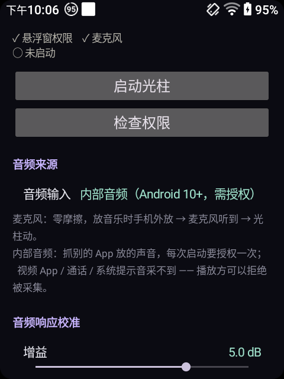
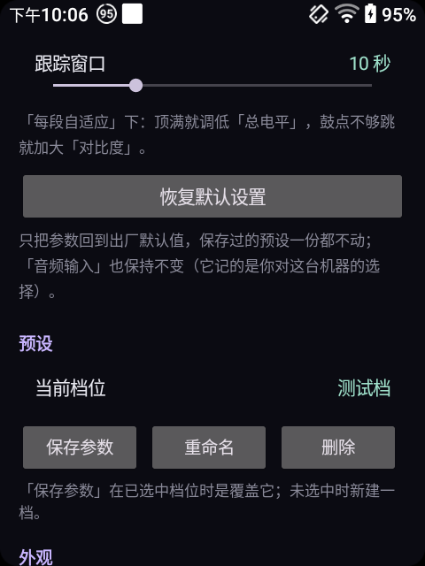

# Android 悬浮窗版

Kotlin + GLES 2.0。全屏透明悬浮窗，只画光、不挡触摸，**不需要 root**。

<div align="center">


</div>

## 构建

需要 **JDK 17** + **Android SDK**（platform 34 / build-tools 34）。

```bash
# 首次：告诉 Gradle SDK 在哪
echo "sdk.dir=/path/to/Android/sdk" > local.properties

./gradlew assembleDebug        # 或 gradle assembleDebug
```

产物：`app/build/outputs/apk/debug/app-debug.apk`

`minSdk = 26`（Android 8.0），`targetSdk = 34`。
依赖只有 `androidx.core` / `appcompat` / `material` —— 没有引入 Compose，
设置页是纯 `LinearLayout` 拼的，包体小、冷启动快。

## 权限

| 权限 | 什么时候要 | 说明 |
|---|---|---|
| `SYSTEM_ALERT_WINDOW` | 必填 | 「显示在其他应用上层」。没有它悬浮窗起不来。 |
| `RECORD_AUDIO` | 用麦克风时 | 运行时申请。 |
| `FOREGROUND_SERVICE_MEDIA_PROJECTION` | 用内部音频时 | 每次启动要授权一次。 |
| `POST_NOTIFICATIONS` | Android 13+ | 前台服务的通知。拒绝也能跑，只是通知不显示。 |

**不需要 root。** 所有能力都走公开 API。

### 内部音频为什么每次都要授权

`MediaProjection` 是系统级的屏幕/音频采集授权，Android 规定**单次有效**，
进程重启就得重新点确认。这是系统限制，绕不过去。

另外：播放方可以声明「不被采集」（视频类 App 常见），这时只能退回麦克风。

## 架构

```
MainActivity ──► SettingsHolder（进程内单例）
                      │
                      ▼
OverlayService ──► RenderThread ──► GlRenderer ──► EGL Surface
   （前台服务）         │                              │
                       ├── Analyzer ◄── AudioEngine     ▼
                       │    (FFT)      (麦克风 /      合成到屏幕
                       │                MediaProjection)
                       └── 每帧读 Settings
```

| 文件 | 职责 |
|---|---|
| `OverlayService.kt` | 前台服务 + 渲染线程 + 探针日志 |
| `GlRenderer.kt` | EGL 初始化、全屏四边形、预乘混合、framebuffer 回读 |
| `Shaders.kt` | GLSL ES，与 `windows/src/shader_src.h` 同源 |
| `AudioEngine.kt` | 麦克风 / MediaProjection 两条采集路径 |
| `Analyzer.kt` | 2048 点 FFT + 8 段包络 + 自适应归一化 |
| `Settings.kt` | 27 键参数表 + `clamp()` |
| `SettingsStore.kt` | ini 读写、预设、`SettingsHolder` 单例 |
| `PanelBuilder.kt` | 设置页控件（滑块 / 开关 / 下拉 / 按钮） |
| `PanelSpec.kt` | 面板项清单（分两段，中间留给预设区） |
| `PresetPanel.kt` | 预设区：保存 / 重命名 / 删除 |
| `SelfCheck.kt` | 自检：喂已知信号，验证分析链 |
| `Themes.kt` | 15 套主题色（与 `data_themes.h` 逐字一致） |

### 为什么设置页和光柱在同一个进程

因为 `SettingsHolder` 是**进程内**单例。界面改参数 → 服务下一帧就读到新值。

⚠ 如果哪天给服务加了 `android:process=":overlay"`，这个前提就破了，
必须换成 Binder / 广播 / 文件监听。否则会退回「改完要重启才生效」的老毛病。

## 诊断

`tools/` 下是移植期间用的真机诊断脚本（纯 Python 标准库 + adb）。

| 脚本 | 用途 |
|---|---|
| `dbg_run.sh` | 起服务、抓探针日志、导出 framebuffer |
| `bi_case.sh` | 「光柱离边距离」单档取证：起覆盖层 → 截图 → 关覆盖层 → 截图 |
| `bi_compose.py` | 把多档差分拼成对照图 |
| `pillar_metrics.py` | 差分几何度量（对称性 / 高度 / 射程 / 中线留空） |
| `reset_case.sh` | 「恢复默认设置」端到端验证 |
| `multires_test.sh` | 多分辨率回归 |
| `uitree.py` | 解 `uiautomator dump` 的 XML，按文字定位控件 |
| `pngtool.py` / `diffmap.py` / `pick_peak.py` / `pillar_scan.py` | PNG 读写与差分工具 |

### 探针日志

```bash
adb logcat -s LightPillar:I
```

每 60 帧一行：

```
probe max=(126,90,131,14)@(0,356 GL) 左轴=(118,84,122) 右轴A=13 |
glow=1.00 alphaK=0.10 idle=0.000 drive=0.236 sub=0.086 bass=0.070 eng=0.022 | vp=480x640
```

- `max=(0,0,0,1)` → 整帧全黑（光柱确实离场了）
- `vp=480x640` → viewport 尺寸，用来确认 `FLAG_LAYOUT_IN_SCREEN` 生效

### 诊断模式

改 ini 里的 `[android] debugMode`：

```bash
adb shell run-as com.lightpillar sh -c 'sed -i "s/debugMode=0/debugMode=1/" files/settings.ini'
adb shell am force-stop com.lightpillar && adb shell am start -n com.lightpillar/.MainActivity
```

`1/2/3` = 整屏纯红/绿/白不透明。配合探针读数可以把「光柱不显示」
切成三种可区分的原因（见 [移植笔记](../docs/移植笔记.md#十怎么证明它真的画对了)）。

界面上**故意不给**这个开关的入口 —— 免得误触把整屏变红。

## 已知限制

- 内部音频抓不到部分 App（播放方可以拒绝被采集）。
- 高刷屏上按「渲染帧率」限帧，默认 60。设 120/144 更顺，但功耗明显上升。
- 竖屏下 `beamInset` 会被自动收窄（见 [移植笔记](../docs/移植笔记.md#beam-inset-aspect)）。
- 部分国产 ROM 会杀后台服务。需要在系统设置里给本应用关掉电池优化。
