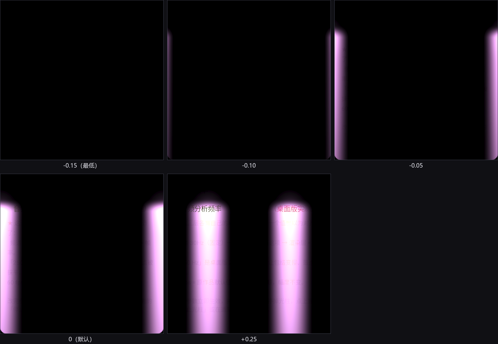

# 移植笔记

这份文档记录的是**踩过的坑**，不是教程。每一条都对应一次真实的失败：
某个值算错、某层没上屏、某个参数改了没反应。写下来是因为它们都很隐蔽 ——
现象往往和原因隔了三层。

目录：

- [一、为什么不直接用 OpenGL](#一为什么不直接用-opengl)
- [二、预乘 alpha：桌面版和网页版唯一的分歧](#二预乘-alpha桌面版和网页版唯一的分歧)
- [三、着色器里的「多余写法」为什么不能删](#三着色器里的多余写法为什么不能删)
- [四、cbuffer 必须全部 float4](#四cbuffer-必须全部-float4)
- [五、鼠标穿透与铺满两边](#五鼠标穿透与铺满两边)
- [六、光柱离边距离为什么在竖屏上不一样](#beam-inset-aspect)
- [七、音频链：三个时钟不是一回事](#七音频链三个时钟不是一回事)
- [八、Android 的 MediaProjection 顺序坑](#八android-的-mediaprojection-顺序坑)
- [九、参数「改了立即生效」的四类坑](#九参数改了立即生效的四类坑)
- [十、怎么证明它真的画对了](#十怎么证明它真的画对了)
- [十一、可复现构建](#十一可复现构建)

---

## 一、为什么不直接用 OpenGL

参考实现是网页版，用 WebGL。最省事的移植路径看起来是「开一个 OpenGL 上下文，把 GLSL 原样贴进去」。

实测不行：目标机器上

```
glGetString(GL_VERSION)  = "1.1.0"
glGetString(GL_RENDERER) = "GDI Generic"
wglGetProcAddress(...)   = null
```

`GDI Generic` 意味着**没有硬件 OpenGL 驱动**，只有 Windows 自带的 1.1 软件实现。
OpenGL 1.1 没有着色器（GLSL 要 2.0 起），所以这条路走不通。

但同一台机器上 D3D11 是好的 —— 因为 Electron 的 WebGL 本来就是 ANGLE → D3D11，
浏览器里能跑，说明 D3D11 通路是通的。

于是：**GLSL → HLSL SM 4.0**，运行时用 `d3dcompiler_47.dll` 编译（系统自带）。
语言转换只做机械替换：

```
vec2/3/4 → float2/3/4     mix → lerp     gl_FragColor → 返回值
varying/uniform → 语义 + cbuffer
```

正文一行没动。这一点很重要：**任何一处「顺手优化」都会让两边的渲染结果对不上**，
而逐像素对照是后面所有验证的基础。

---

## 二、预乘 alpha：桌面版和网页版唯一的分歧

网页版：

```glsl
gl_FragColor = vec4(bg + col, 1.0);   // 不透明，自己画主题底色
```

桌面版要的是「只加光，不盖黑底」。所以不能输出不透明像素，要输出**光**：

```hlsl
float a = max(max(col.r, col.g), col.b) * uAlphaK + 0.004;
return float4(col, a);
```

交换链必须显式声明 `DXGI_ALPHA_MODE_PREMULTIPLIED`，
DirectComposition 才会按预乘规则合成：

```
结果 = RGB + 桌面 × (1 − A)
```

**`RGB` 是满亮度的光，不被 `A` 缩放。** 这一点搞反（把颜色也乘上 alpha）
会让光柱在 `alphaK` 低时变得又暗又灰 —— 而 `alphaK` 默认就是 0.10。

末尾的 `+0.004`（1/255）是保险：`uAlphaK = 0` 且 `col` 全 0 时整层 alpha 会是 0，
部分合成路径会把「完全透明的图层」整层丢掉，光柱就凭空消失了。
代价是桌面被压暗 0.4%，肉眼不可见。

> Android 侧同理，但走的是另一套：`GLES` 的 `glBlendFunc(GL_ONE, GL_ONE_MINUS_SRC_ALPHA)`
> —— 这就是预乘 alpha 的混合函数。写成 `GL_SRC_ALPHA, GL_ONE_MINUS_SRC_ALPHA`
> 会二次乘 alpha，结果是柱子边缘发灰、中心过亮。

---

## 三、着色器里的「多余写法」为什么不能删

参考实现的 GLSL 里有几处看起来可以简化的地方。每一处都**不能**动：

### `smoothstep` 而不是 `pow`（柱身）

```glsl
float g = 1.0 - smoothstep(0.0, WX, d);
```

`smoothstep` 在两端导数都为 0，靠近边缘时「平缓地贴到 0」，射程才会稳定钉在 `WX` 上。
换成 `pow` 的话，边缘会有一条硬过渡，柱子看起来像被裁过。

### `pow` 而不是 `smoothstep`（柱顶光晕）

```glsl
halo = pow(max(1.0 - rr, 0.0), 2.2) * head2;
```

反过来 —— 这里**必须**用 `pow`。`smoothstep` 在 `rr` 小时导数为 0，
会形成一个亮度平坦的圆盘 + 一条清晰的圆边，看起来像在柱顶贴了个圆上去。
`pow` 在中心导数为 0 但衰减连续，才是「自然发散的一团光」。

### `drive` 必须在分支外算

```glsl
float drive = clamp(low * uAudioIntensity * uResponseRange, 0.0, 1.70);
if (uStyleMode < 0.5) { h = drive * 0.62; ... }
else                  { flash = smoothstep(0.18, 0.95, drive); ... }
```

它是两种风格**共享**的那一根驱动量：风格① 拿它当柱高，风格② 拿它当闪烁强度。
写进任何一个分支里，另一种风格就再也拿不到它了。

### 呼吸必须是「有基数的叠加」

```glsl
breathe = 0.66 + 0.20*sin(t*0.55) + 0.14*sin(t*0.23 + 1.7);
h += max(0.0, breathe) * uIdleWave * 0.48;
```

写成两个正弦的**乘积**（看起来更「自然」）会让谷底归零，光柱会周期性整个消失。
`0.66` 这个基数就是为了保证永不为负。

### 强调色染的是 `c`，不是最终颜色

```glsl
c = lerp(c, cPk, pk * 0.45);      // ✓ 染基色
```

如果改成染最终输出（`col = lerp(col, cPk*..., ...)`），会把**没点亮的地方**一起泛色 ——
柱子周围那圈本该是纯黑的空间会蒙上一层强调色。

### 颜色必须先 `lin2srgb`

主题色在 Three 的 `Color` 里是**线性**值，而这一份是自定义 `ShaderMaterial`、
直接把颜色写进帧缓冲（不参与 Three 的输出色彩空间转换）。
所以要先转 sRGB，否则整块画面会比页面上那块背景色暗一大截。

---

## 四、cbuffer 必须全部 float4

HLSL 的 cbuffer 打包规则是「变量不能跨 16 字节边界」。裸 `float2` 落在 offset 12 时
HLSL 会把它挪到 16，而 C++ 侧的结构体不会 —— 这是最经典的一类**静默错位**：
uniform 值全对、画面就是不对。

解决办法是**全部用 `float4` 打包**，C++ 侧 `memcpy` 进去必然对齐：

```hlsl
cbuffer LpParams : register(b0) {
  float4 P0;   // xy = uRes, z = uStyleMode, w = uBeamInset
  float4 P1;   // x = uAudioIntensity, y = uResponseRange, ...
  ...
};
#define uRes        (P0.xy)
#define uStyleMode  (P0.z)
```

正文里仍然用原名，所以和参考实现逐行对应，改起来不用换脑子。

---

## 五、鼠标穿透与铺满两边

Windows 上「透明 + 不挡点击」需要同时满足：

- `WS_EX_LAYERED` —— 允许 alpha
- `WS_EX_TRANSPARENT` —— 命中测试穿透
- `WS_EX_NOACTIVATE` —— 点击不抢焦点
- 扩展样式 `WS_EX_NOREDIRECTIONBITMAP`（配合 DirectComposition）

**但 `WS_EX_TRANSPARENT` 只在「同一个线程的窗口之间」保证顺序**，
跨进程时 Windows 仍可能把点击投给覆盖层。实测的可靠做法是：
窗口只覆盖屏幕，**不注册任何鼠标消息处理**，并且用 `SetWindowPos(HWND_TOPMOST)`
而不是 `WS_EX_TOPMOST` 保持最上层。

「铺满两边、不避让任务栏」需要 `FLAG_LAYOUT_IN_SCREEN`（Android）
或 `WS_EX_TOOLWINDOW` + 全屏尺寸（Windows）。默认行为会自动避开任务栏，
这和「铺满整块屏」是相反的。

> Android 侧验证方式：探针日志里打出 `vp=480x640`。如果打出的是 `480x600`，
> 说明被状态栏/导航栏避让了。

---

<a id="beam-inset-aspect"></a>
## 六、光柱离边距离为什么在竖屏上不一样

这一条是移植过程中唯一一处**故意偏离参考实现**的地方，值得单独说。

着色器里横向射程是个常数：

```glsl
float WX = 0.26;                        // 以「画面高」为单位
float dx = e0 * asp;                    // asp = 屏宽 / 屏高
float g  = 1.0 - smoothstep(0.0, WX, d);
```

光柱「整根离场」的条件是 `dx > WX`，也就是：

```
|inset| × asp > 0.26        ⟺        |inset| > 0.26 / asp
```

代入滑块最低位 `inset = -0.15`：

| 屏幕 | asp | 阈值 `0.26/asp` | `0.15` 够不够离场 |
|---|---|---|---|
| 16:9 桌面 | 1.778 | 0.1462 | 够 ✓ |
| 竖屏手机 | 0.75 | 0.3467 | **远远不够** ✗ |
| 横屏手机 | 1.779 | 0.1462 | 够 ✓ |

参考实现的目标是 16:9 显示器，没有做纵横比补偿 —— 在桌面上没问题。
但到了竖屏手机上，`-0.15` 时柱子还剩一大段，用户的第一反应是「坏了」。

**修法**：让 `WX / asp` 在所有纵横比下恒等于 16:9 的 0.1462：

```glsl
float WX = 0.26 * min(1.0, asp / 1.778);
if (abs(uBeamInset) > 0.001) {
    WX = min(WX, abs(uBeamInset) * asp * 0.9);
}
```

- 宽屏（`asp ≥ 1.778`）：`min(1.0, ...)` 取 1，**原样不动**。
- 窄屏：按比例收窄，顺带把「柱子占屏宽的比例」也钉住了 ——
  不改的话竖屏上两根柱子会各占屏宽 1/3，糊在一起。
- 第二行：`inset` 一离开 0 就把射程压到「刚好离场」以内，`0.9` 是留 10% 余量
  避免浮点边界抖动。

真机五档扫描（480×640，`drive` 被钉在 0.90）实测射程：

| `beamInset` | −0.15 | −0.10 | −0.05 | 0 | +0.25 |
|---|---|---|---|---|---|
| 实测 | **0 px** | 17 px | 41 px | 65 px | 130 px |
| 理论 `(0.1462 + inset) × 480 − 5` | 0 | 17.2 | 41.2 | 65.2 | 130.4 |

跨分辨率复核：480×640 和 720×1280 上「射程占屏宽」**都是 13.5%**
（修正前是 32.1% / 42.8%）。

<div align="center">

</div>

> 图是「有覆盖层 − 无覆盖层」的差分，底是纯黑，只剩覆盖层画上去的光。
> 那几个淡淡的字是底图文字的抗锯齿残影，不影响几何结论 ——
> 定量判据里「光柱以外增量 > 3 的像素」是 **0 个**。

---

## 七、音频链：三个时钟不是一回事

```
频谱采集 30 Hz（固定）→ 分析层 anaHz → 渲染层 fpsLimit
```

一开始把 `anaHz` 默认写成了 60（想当然地跟帧率对齐），结果是：
**幅度比 Electron 版小、部分节拍完全不响应**。

原因：桌面版那个分析定时器实测跑 249.6 次/秒。降到 60 等于把包络的时间常数拉长 4.5 倍，
鼓点这种 100 ms 量级的瞬态在包络上只剩一个小鼓包，被后面的归一化直接抹平。

默认值必须是 **250**，而且 `clamp()` 里的兜底值也必须是 250 ——
如果兜底写 60，用户 ini 里一个非法值就会静默退回「慢 4.5 倍」的状态。

另一个坑：**分析层和渲染层的同步要分轻重两档**。

```kotlin
fun syncAnalyzer(doInit: Boolean = false) {
    // 重档：改这些要重建整条分析链
    if (bandMode != prevBand || mapMode != prevMap || loPct != prevLoTrack ||
        hiPct != prevHiTrack || rpWinSec != prevWin || anaHz != prevHz ||
        gainDb != prevGain || widthDb != prevWidth) { paramsChanged() }
    // 轻档：改这些只调倾斜曲线
    if (balance != prevBal || contrast != prevContrast || level != prevLevel) { rebuildTiltOnly() }
}
```

全都走重档的话，拖一下「频谱平衡」滑杆就会每秒重建 60 次 FFT —— 卡成幻灯片。
全都走轻档的话，改「频率轴」不会生效。

---

## 八、Android 的 MediaProjection 顺序坑

Android 10+ 规定：`MediaProjection` 必须在**已启动的** `mediaProjection` 类型前台服务里获取，
否则抛 `SecurityException`。

而这个异常是在 `onActivityResult` 里抛的 —— 表现是**一点授权就闪退**，
堆栈指向授权回调，看起来像是「授权失败」，实际是「服务还没起来」。

正确顺序：

```
onActivityResult 拿到 (resultCode, data)
  → 交给 ProjectionHolder（只存原始值，不解包）
  → 服务里先 startForegroundCompat()
  → 再 obtainProjection()
```

不能反过来，也不能在 Activity 里先 `getMediaProjection()` 再传进服务。

---

## 九、参数「改了立即生效」的四类坑

这一组是用户报得最多的：「参数调完要停止再打开才生效」。

### 坑 1：两个 `SettingsStore` 实例

`MainActivity` 和 `OverlayService` 各自 `SettingsStore(this)`，
写的是同一个文件、读的是各自内存里的对象。界面改了参数 → 写文件 → 服务那份还是旧的。

修法：进程内单例 `SettingsHolder.get(ctx)`，`bootstrap()` 幂等。

> 前提是服务和 Activity 在**同一个进程**。如果哪天给服务加了
> `android:process=":overlay"`，这个单例就破了，必须换成 Binder / 广播 / 文件监听。

### 坑 2：下拉框「错位一格」

主题下拉的第 0 项是「自动轮询」占位，它不是一个值 = 0 的普通选项，
而是**同时**要改 `themeAuto` 这个布尔键：

```kotlin
g_themeSel = themeAuto ? 0 : (themeIndex + 1);          // 显示
if (sel <= 0) themeAuto = true;                          // 选择
else { themeAuto = false; themeIndex = sel - 1; }
```

按通用下拉直接存下标的话，选「霁紫」渲染出来是「沧蓝」—— 错位一格。

### 坑 3：载入后不钳制

`ini` 和预设文件是用户能直接改的文本，也是 `adb` 调试时会改的东西。
最要命的一项不是「值难看」，是 `hiPct <= loPct`：

```
lin = (bandDb - lo) / span     // span → 0 → 归一化爆掉
```

载入 ini / 套用预设之后**必须**调一次 `clamp()`，并且 `hi` 要强制 `> lo`。

### 坑 4：控件只在 build 时读一次初值

「恢复默认设置」按钮点下去，`store` 变了，但面板上所有滑块还停在旧值上 ——
用户看到「点了没反应」，参数其实早改了。

修法：`PanelBuilder` 维护一张刷新器表，每个控件在创建时登记自己的同步动作：

```kotlin
private val refreshers = mutableListOf<() -> Unit>()
fun refreshAll() { for (r in refreshers) r() }
```

按钮、开关、下拉、预设区各登记一个。没有这一层，「恢复默认」永远看起来是坏的。

---

## 十、怎么证明它真的画对了

移植类项目最容易陷入「看起来差不多」。这个仓库的做法是**先给一个可证伪的定量预测，
再去测**，而不是「截图看着像」就收工。

### 探针（probe）

每 60 帧把 framebuffer 读回来一次，打一行日志：

```
probe max=(126,90,131,14)@(0,356 GL) 左轴=(118,84,122) 右轴A=13 |
glow=1.00 alphaK=0.10 idle=0.000 drive=0.236 sub=0.086 bass=0.070 eng=0.022 | vp=480x640
```

`max=(0,0,0,1)` 意味着整帧全黑 —— 这是「光柱确实离场」的硬证据，
比任何截图都可靠。

> ⚠ 探针里打的值必须是**真正送进着色器的那个值**。曾经 `drive=` 打的是 CPU 侧真值，
> 而 `debugMode` 会把驱动量钉在固定值 —— 日志说 `drive=0.066`、画面却按 0.90 渲染，
> 排查时被它带偏过一次。

### 诊断模式：把「不显示」切成三种可区分的原因

`debugMode = 1/2/3` 让整屏输出纯红/绿/白不透明。配合探针读数：

| 探针 | debug=1 | 结论 |
|---|---|---|
| 全 0 | 不显示 | 着色器 / 参数问题 |
| 非 0 | **显示** | 图层在屏上，问题在 alpha / 预乘合成 |
| 非 0 | 不显示 | 图层压根没上屏，调 alpha 无用 |

这三种在截图里长得一模一样。没有这个开关就只能猜。

### 差分几何度量

「有覆盖层」和「无覆盖层」两张截图相减，剩下的**只有**覆盖层画上去的光。
然后量：左右柱高差、左右射程差、中线是否为空、镜像对称性。

判据是**必须成立**的恒等式，不是「看起来对」：

- 左右高度差应为 **0 px**
- 左右射程差应为 **0 px**
- 两柱之间（中线）增量应 **≈ 0**

> 度量时必须裁掉顶部状态栏（约 48 px）：状态栏的时间/信号/电量在两张截图之间会变，
> 差值比光效还大 —— 实测「最亮点」一度落在状态栏上（增量 244），把结论全带偏。
>
> 同理，差分前要确认两次截图之间桌面没有重绘。踩过两次：一次是桌面图标异步加载，
> 一次是桌面大时钟跳分钟。最后改成「两次都走同一套流程、等同样长的稳定时间」。

### 带哨兵值的自检

`SelfCheck` 喂一段已知信号进分析链，检查输出的每一段是否落在预期区间。
容差用 `1e-6` 而不是 `1e-9` —— 后者会把 `Float→Double` 的 1e-8 量级误差判成错。
喂满 10 秒（滚动直方图窗口 = 300 帧），否则 `subBass` 会因为窗口没填满被误判成「坏了」。

---

## 十一、可复现构建

`build.sh` 加了 `-Wl,--no-insert-timestamp`。

默认 lld 会把「链接时刻」写进 PE 头（`e_lfanew + 8`，4 字节），
于是同一份源码两次构建 md5 不同 —— 实测差异恰好只有 2 个字节（时间戳低 16 位），
`.text` / `.rdata` / `.rsrc` 等七段 md5 全同。

这会让人误以为「发布的 exe 和源码对不上」。关掉之后，文档里写的 md5
才是一把真的尺子：**md5 变了就说明代码真的变了**。

同理，`gen_data.js` 从参考实现 bundle **逐字抽取**主题色表，而不是手抄：
15 套 × 4 个颜色 = 60 个线性色值，抄错一个小数点整根柱子就偏色。
抽取出来的 `data_themes.h` 进版本库，所以没有参考实现 bundle 也能编译。
